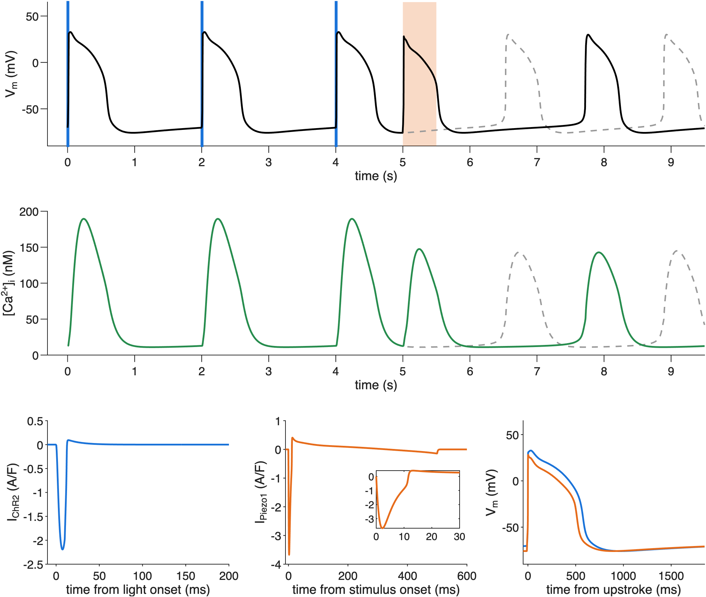

# hiMCES2026–Piezo1–ChR2: Model code for optical and mechanical pacing of human iPSC-derived cardiomyocytes

[](https://doi.org/10.5281/zenodo.23430167)

MATLAB code reproducing Fig. 8A and Supplementary Fig. S5 of
[Pettebone, Han et al. (bioRxiv, 2026)](https://doi.org/10.64898/2026.10.19.760310),
with scripts, conditioned initial states and reference outputs for qualitative
single-cell simulations of optical and mechanical pacing.

The published hiMCES2026 host (equations and parameters unchanged) is combined with
ChR2 after Williams et al. (2013) and a modified two-gate Piezo1 model based on
Forouzandehmehr et al. (Computing in Cardiology, 2023). Component credits and licences
are in [NOTICE.md](NOTICE.md).



*Fig. 8A reproduced by `MasterCompute_OptoSono.m`. Blue marks the three light pulses;
orange marks the mechanical pulse. Dashed grey traces show the same cell without the
mechanical pulse. The bottom row shows ChR2 current, Piezo1 current (with the first
30 ms enlarged), and action potentials aligned at the upstroke.*

The [Zenodo archive](https://doi.org/10.5281/zenodo.23430167) preserves software
version 1.0.0 used for the preprint. Documentation on `main` may be updated independently;
these presentation changes do not alter the model or reference outputs.

## Requirements

MATLAB, base product only (no toolboxes). Tested with MATLAB R2026a Update 2 on macOS.
Reference simulations use the variable-step, double-precision solver described below.
Fixed-step and single-precision ports have not been verified by this release.

## Quick start

Download and extract the [v1.0.0 release](https://github.com/aminforouzandehmehr/hiMCES2026-OptoSono/releases/tag/v1.0.0),
or clone this repository. Open MATLAB with the extracted or cloned repository as its
current folder, then run:

```matlab
MasterCompute_OptoSono          % Fig. 8A and both controls (about 10 s)
FigureS5_Piezo1                 % Supplementary Fig. S5 (about 10 s)
ok = verify_release()           % equation checks and reproduction (about 20 s)
ok = verify_release('full')     % also re-conditions both cells and runs all channel checks (about 3 min)
```

Set `saveFigs = 1` in the two figure scripts to write PDF and PNG files to `results/`.
All scripts write only to `results/`; the supplied initial conditions and references are
never overwritten.

`verify_release` checks reproduction of the preprint reference runs and exact agreement
with the published hiMCES2026 host derivatives and outputs at the sampled test states
when both added currents are off. The full check also repeats conditioning and channel
measurements.

## Protocol of Fig. 8A

| Item | Value |
|---|---|
| Temperature, bath | 304 K (31 °C), Tyrode solution (`classicVSoptic = 1`, `X.T_override = 304`) |
| Light (ChR2) | 10 ms pulses at 0.15 mW/mm², at 0, 2 and 4 s (0.5 Hz) |
| Mechanical pulse (Piezo1) | 0.336 kPa effective stress at the Piezo1 gate, 0.5 s, from 5.0 s (1 s after the third light pulse) |
| Controls | the same cell without the mechanical pulse; the cell with the Piezo1 current off |
| Initial state | `initial_conditions/OptoSono_31C_Piezo1.mat` (40 states) and `..._Piezo1off.mat` (39 states), at the onset of a light pulse after 1000 s of 0.5 Hz light pacing |
| Solver | `ode15s`, RelTol 1e-7, AbsTol 1e-10, MaxStep 0.5 ms; integration cut at every pulse edge (`model/run_segments.m`) |

The mechanical input is an effective stress added at the Piezo1 activation gate. It is
not converted from, or calibrated to, an acoustic pressure or ultrasound intensity.
Only 0.5 s mechanical pulses were simulated; shorter pulses were not tested.

## Model

States 1 to 33: published hiMCES2026. States 34 and 35: Piezo1 activation gate and
availability. States 36 to 39: ChR2 (O1, O2, C2, p). State 40: native stress filter
(present only when `X.tau_trans` is set; not a Piezo1 gate). Fig. 8A uses all 40 states;
the Piezo1-off control has 39. State names and units: `initial_conditions/*.csv`.

<details>
<summary>Diagnostic outputs</summary>

Outputs `dati(1:48)` are those of the published model. Added outputs: 49 I_Piezo1 (A/F),
50 Ca²⁺ flux counted for Piezo1 (mM/s), 51 stress sensed by the activation gate (kPa),
52 steady state of the activation gate, 53 steady state of the version 1.1 voltage gate,
54 time constant of the second gate (s), 55 mechanical pulse on, 56 I_ChR2 (A/F),
57 light on, 58 ChR2 C1 fraction, 59 Na⁺ share of I_Piezo1 (A/F), 60 recovery time
constant (s).

</details>

Modified Piezo1 model (`X.gating = 'reduced'`):

$$
I_{\mathrm{Piezo1}} = g_P a h (V_m-E_P), \qquad E_P=0.
$$

$$
\frac{da}{dt}=\frac{a_\infty(\sigma)-a}{\tau_a(T)}, \qquad
 a_\infty(\sigma)=\frac{1}{1+\exp\!\left[-\frac{5\sigma/\sigma_{\mathrm{ref}}-2.5}{0.25}\right]}.
$$

$$
\sigma=\sigma_{\mathrm{cell,s}}+\sigma_{\mathrm{stim}}, \qquad
\frac{d\sigma_{\mathrm{cell,s}}}{dt}=\frac{\sigma_{\mathrm{cell}}-\sigma_{\mathrm{cell,s}}}{\tau_{\mathrm{tr}}}.
$$

$$
\frac{dh}{dt}=\frac{1-h}{\tau_{\mathrm{rec}}(T)}
 -\frac{a h}{\tau_{\mathrm{inact}}(v,T)}.
$$

$$
\tau_{\mathrm{inact}}(v,T)=q_T k_{\mathrm{inact}}(0.3\,\mathrm{ms})\alpha(v)\beta(v),
\qquad v=1000 V_m.
$$

$$
\alpha(v)=\frac{1}{\sqrt{1+\exp[(v-60)/50]}}, \qquad
\beta(v)=\frac{900}{1+\exp[(171-v)/72]}.
$$

Here, $a$ is activation, $h$ is availability, $V_m$ is membrane voltage in V,
and $v$ is its numerical value in mV. Current is per membrane capacitance (A/F).
The sensed stress $\sigma$ (kPa) combines filtered native cell stress
$\sigma_{\mathrm{cell,s}}$ with the applied stress $\sigma_{\mathrm{stim}}$.
Only native stress is filtered; the applied stimulus reaches the gate directly.

The three gate time constants scale from 295 K by
$q_T=2^{(295-T)/10}$, where $T$ is in K:
$\tau_a(T)=q_T\tau_a(295)$ and
$\tau_{\mathrm{rec}}(T)=q_T\tau_{\mathrm{rec}}(295)$.
The stress-filter time constant $\tau_{\mathrm{tr}}$ is not temperature-scaled.

| Parameter | Value in Fig. 8A | Basis |
|---|---|---|
| $g_P$ | 91.17 S/F (300 × 0.3039 S/F; about 9 nS per cell) | Conductance scale chosen for the simulation; not measured |
| $\sigma_{\mathrm{ref}}$ | 0.336 kPa (half activation at 0.168 kPa) | Chosen for the simulation; version 1.1 uses 0.056 kPa |
| $\tau_{\mathrm{tr}}$ | 0.15 s | Assumption |
| $\tau_a$ | 3.162 ms at 295 K | Fitted to deactivation; activation assumed equal |
| $k_{\mathrm{inact}}$ | 0.9098 | Fitted to voltage-dependent decay |
| $\tau_{\mathrm{rec}}$ | 0.2023 s at 295 K | Fitted to half recovery |
| $Q_{10}$ | 2 for the three gate time constants (factor 0.5359 at 304 K) | Assumption |
| $f_{\mathrm{Ca}}$ | 0.05 of the inward current as Ca²⁺, rest Na⁺ | Approximation derived from permeability ratios; not a measured current fraction |

`model/OptoSono_settings.m` returns these settings. The defaults of
`model/ChR2_Piezo1_opts.m` are the published values of version 1.1 and are not the
Fig. 8A configuration.

## Calibration and checks of the Piezo1 gates

The three kinetic parameters were fitted to the isolated channel
([model/Piezo1_channel.m](model/Piezo1_channel.m)) using the experimental protocols
in [calibration/](calibration/). Room-temperature recordings are represented at 295 K
(approximately 22 °C); whole-cell and cell-attached protocols are distinguished below.

| Quantity / protocol | Source | Experimental target | Model | Use and agreement |
|---|---|---|---|---|
| Whole-cell decay, −60 to +20 mV | Wu et al. 2017, Fig. 1B | 9.12–24.09 ms across five voltages | 10.16–21.26 ms | Fit: 5/5 within plotted error bars |
| Whole-cell decay, −60 to +20 mV | Zheng et al. 2019, Fig. 2H | 10.75–26.80 ms across five voltages | 10.16–21.26 ms | Fit: 4/5 within plotted error bars; +20 mV missed (26.80 ± 3.24 ms vs 21.26 ms) |
| Deactivation at −80 mV, cell-attached | Lewis et al. 2017, Fig. S4I | 4.0 ms, fast component | 3.86 ms | Fit: within assigned 20% tolerance |
| Half recovery at −80 mV, cell-attached | Lewis et al. 2017, Fig. S4F | 0.140 s, interpolated from recovery curve | 0.144 s | Fit: within assigned 20% tolerance |
| Human PIEZO1 decay at −80 mV, whole-cell | Albuisson et al. 2013 | 8.6 ± 0.4 ms (SEM) | 8.33 ms | Check: within ±2 SEM |
| Mouse Piezo1 decay at −100 and −80 mV, whole-cell | Wu et al. 2017; Zheng et al. 2019 | Wu: 8.5 and 8.0 ms; Zheng: 11.9 ± 0.6 ms (SEM) | 6.77 and 8.29 ms | Check: 1/3 passes (Wu at −80 mV); Wu at −100 mV and Zheng at −80 mV missed |
| Mouse Piezo1 decay, +40 to +100 mV, whole-cell | Wu et al. 2017, Fig. 1B | 33–95 ms | 24.5–32.4 ms | Check: 0/4 within assigned 20% tolerance |
| Current left after 300 ms at −80 mV, cell-attached | Lewis et al. 2017, Fig. S1E | 0.096 ± 0.040 (SD), fraction of peak | 0.060 | Check: within ±2 SD |
| Recovery curve at −80 mV, cell-attached | Lewis et al. 2017, Fig. S4F | Two-phase recovery; see full report | Recovery too fast at intermediate delays | Partly calibrated: 1/13 untied points within ±2 SEM; the 0.16 s point is tied to the fitted half recovery and excluded from this count |
| Trains of 30 ms stimuli at 0.5–10 Hz, cell-attached | Lewis et al. 2017, Fig. 3B | Progressive depression; see full report | Too little depression | Check: first peaks 3/5, last peaks 1/5 within ±2 SEM |

Fit targets and their plotted error bars were digitized; additional Wu check values
were read from the figure and use an assigned 20% tolerance. See
[Piezo1_targets.m](calibration/Piezo1_targets.m) for the values and source details,
[fit_report.txt](reference_outputs/fit_report.txt) for the original fit, and
[check_report.txt](reference_outputs/check_report.txt) for every check and its allowance.
Counts are reported by protocol, not pooled into a validation score. Checks were not
used in the fit.

`calibration/check_Piezo1.m` writes the full table (`reference_outputs/check_report.txt`
holds it for the frozen parameters). `calibration/fit_Piezo1.m` repeats the fit
(optional, several minutes); it writes to `results/` and does not change the frozen
parameters in `model/ChR2_Piezo1_opts.m`. The original fit report is in
`reference_outputs/fit_report.txt`.

## Scope and limitations

- **Single cell, qualitative.** No acoustic propagation, actuator spheroids or tissue
  coupling are simulated. Mechanical input is an effective gate stress, not a calibrated
  ultrasound pressure. Fig. 8A uses 0.5 s pulses at 31 °C; the experiments were at room
  temperature. Shorter mechanical pulses were not tested in this release.
- **Mechanical input.** Whole-cell myofilament stress stands in for membrane tension.
  Its mapping to activation, the 0.15 s filter, the conductance scale and
  $\sigma_{\mathrm{ref}}$ are uncalibrated assumptions or simulation settings
  (see the parameter table).
- **Channel kinetics.** A single recovery time constant does not reproduce slow
  recovery or sufficient depression during repeated stimuli; inactivation is faster
  than measured above +20 mV (see Calibration). With $E_P=0$, current turns outward
  at positive voltages (up to +0.41 A/F in Fig. 8A); its size is not validated in
  cardiomyocytes.
- **Ion accounting.** Inward Piezo1 current has a fixed 5% Ca²⁺ share, with the rest
  assigned to Na⁺; outward current is treated as K⁺ with fixed intracellular K⁺.
  ChR2 current enters the membrane potential equation but no ion balance.
  Calcium results are qualitative.

## Files

| Path | Content |
|---|---|
| `MasterCompute_OptoSono.m` | Fig. 8A and controls |
| `FigureS5_Piezo1.m` | Supplementary Fig. S5 and channel values |
| `condition_OptoSono.m` | conditioning of the two cells from `initial_conditions/start_31C_*.mat` |
| `verify_release.m` | equation checks and reproduction of the references |
| `model/` | `hiMCES2026_ChR2_Piezo1.m` (model), `ChR2_Piezo1_opts.m`, `OptoSono_settings.m`, `Piezo1_channel.m`, `run_segments.m`, `host_arguments.m`, `heav.m`, `passiveForces.m` |
| `analysis/` | upstroke times, APD90 and the Fig. 8A measurements |
| `calibration/` | targets with sources, channel protocols, checks, optional fit |
| `initial_conditions/` | conditioned states (MAT and CSV with state names and units) and conditioning start states |
| `reference_outputs/` | Fig. 8A traces (1 ms) and end states, measurements, threshold scan, Fig. S5 curve, channel measurements, check and fit reports |
| `upstream/` | unchanged published `hiMCES2026.m` and `Piezo1.m` (version 1.1) with their licences, used by `verify_release.m` |
| `verification/` | sampled host states for the equation checks |
| `docs/Figure8A.png` | preview exported by the Fig. 8A script |
| `MANIFEST.sha256` | SHA-256 checksums of all files |

## Licence and citation

[MIT License](LICENSE); upstream notices in [NOTICE.md](NOTICE.md). Please cite the
[software DOI](https://doi.org/10.5281/zenodo.23430167) and the
[preprint](https://doi.org/10.64898/2026.10.19.760310).
GitHub's **Cite this repository** menu uses [CITATION.cff](CITATION.cff).

The ChR2 equations are those of Williams et al.,
PLoS Comput Biol 2013;9(9):e1003220 (DOI 10.1371/journal.pcbi.1003220); the host
model is Li et al., J Mol Cell Cardiol Plus 2026;15:100834
(DOI 10.1016/j.jmccpl.2026.100834); the original Piezo1 model is Forouzandehmehr et
al., Computing in Cardiology 2023;50 (DOI 10.22489/CinC.2023.359).

<details>
<summary>BibTeX for the preprint</summary>

```bibtex
@article{Pettebone2026OptoSono,
  author  = {Pettebone, Morgan E. and Han, Julie L. and Forouzandehmehr, Amin and
             Chesla, Olivia and Chua, Christianne J. and Pozo, Maria R. and
             Heinson, Yuli W. and Liu, Wei and Entcheva, Emilia},
  title   = {Optogenetic and sonogenetic pacing of unmodified cardiac tissue upon
             quick integration with specialized biological actuators},
  journal = {bioRxiv},
  year    = {2026},
  doi     = {10.64898/2026.10.19.760310},
  url     = {https://doi.org/10.64898/2026.10.19.760310}
}
```

</details>
